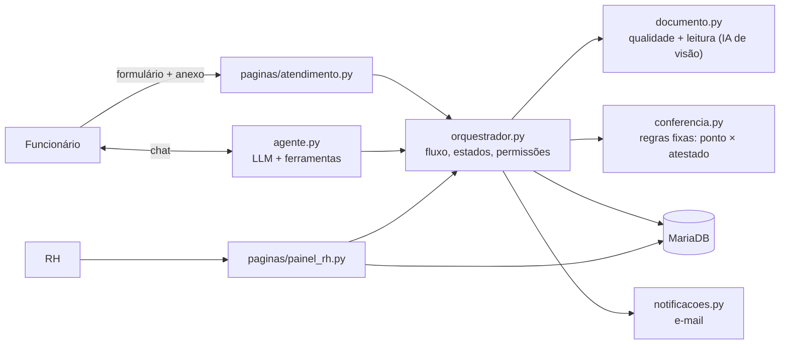

# Sinergia · Agente de RH (versão 2)

O funcionário preenche um **formulário** com os dados do atestado. O agente **lê o documento**, **confere com o ponto eletrônico** e, se encontrar alguma divergência, **abre um chat** para pedir esclarecimentos. No fim, **avisa o RH por e-mail**. No **painel**, o RH vê cada caso com uma cor, o calendário do ponto, a resposta do funcionário, e confirma ou descarta cada alerta.

Tudo roda em `localhost`. O banco é a MariaDB local, e os dados são fictícios: 10 funcionários com 30 dias de ponto.

## O que mudou em relação à v1

| v1 | v2 |
|---|---|
| Chat pedia os dados um a um | **Formulário** com validação: o ID precisa existir e o nome precisa conferir |
| IA só dizia o tipo e se estava legível | IA também **lê nome, data de início e dias** do documento |
| Sem ponto | **Ponto simulado** e **8 alertas** calculados por regras fixas em Python |
| Chat terminava no protocolo | Chat **pergunta só o que falta**: explicações dos alertas, contato, e-mail e complemento |
| Sem e-mail | **E-mails** de confirmação, aviso ao RH e andamento (simulação ou Gmail) |
| Painel com lista e status | Painel com abas: **atestados**, **ponto em calendário**, **caixa de saída** e **indicadores**; o RH confirma ou descarta alertas |

## Arquitetura (um agente com ferramentas)



- **LLM (Groq):** conversa, interpreta as respostas e escolhe as ferramentas: `registrar_resposta`, `registrar_preferencias`, `registrar_complemento`, `consultar_situacao` e `finalizar_atendimento`.
- **Ferramentas Python:** validação, leitura do documento, conferência com o ponto e envio de e-mail. Datas e horários **nunca** são conferidos pelo LLM.
- **Orquestrador:** controla os estados do caso e as permissões. O agente não decide nada sobre o atestado, não altera o ponto e não muda o cadastro: isso só acontece por decisão do RH no painel.
- **Objetivo do agente:** a lista de pendências, calculada pelo Python a partir do formulário, do documento e dos alertas. Se o LLM tentar finalizar antes da hora, a ferramenta recusa e devolve o que falta.

Estados do caso: `em_atendimento` → `aguardando_rh` (há alertas) ou `sem_pendencias` → `resolvido`.

## Alertas (`conferencia.py`)

| Código | Alerta | Gravidade | O agente pergunta? |
|---|---|---|---|
| A1 | Ponto registrado durante o afastamento | alta | sim |
| A2 | Faltas sem justificativa até 3 dias úteis antes/depois | média | sim |
| A3 | Formulário diferente do documento (início, dias ou tipo) | média | sim |
| A4 | Atestado duplicado (mesmo arquivo) ou período já coberto | alta | sim |
| A5 | Mais de 15 dias: a partir do 16º, INSS | média | só informa |
| A6 | Nome no documento diferente do cadastro | média | sim |
| A7 | IA não conseguiu ler o documento: conferir à mão | baixa | não |
| A8 | Sem documento válido (ilegível ou recusado) | alta | pede reenvio |
| C1 | Funcionário pediu para atualizar telefone/e-mail | baixa | criado no chat; o RH aprova |

Exceções que evitam falso alerta:
- **Declaração de comparecimento** cobre só horas, então presença no ponto no mesmo dia é esperada.
- **1º dia com saída cedo** (antes da metade da jornada) é entendido como saída para o atendimento.
- **Fins de semana e feriados** não contam como dia de trabalho.

Todos os limites ficam em `config.py`.

## Cores do painel: quem precisa agir

| Cor | Situação |
|---|---|
| 🔴 | O RH precisa agir já: alerta grave aberto (A1, A4 ou A8) |
| 🔵 | Aguardando o RH: alertas para conferir, ou chat não concluído com alertas |
| 🟡 | Com o funcionário: ainda no chat |
| 🟢 | Ponto de acordo com o atestado |
| ⚪ | Resolvido pelo RH |

## Os 10 cenários de teste

`python preparar_banco.py` gera o ponto com estes casos e um atestado sintético para cada um (marca d'água "SEM VALIDADE"). As datas são relativas ao dia em que você roda o comando. O roteiro com as datas exatas fica em `exemplos/cenarios/ROTEIRO.md`.

| ID | Funcionário | Cenário | O agente deve |
|---|---|---|---|
| FUNC001 | Ana Oliveira | Faltas batem com o atestado | não alertar (controle) |
| FUNC002 | Bruno Santos | Ponto batido no 2º dia útil do afastamento | A1 |
| FUNC003 | Carla Ferreira | 2 faltas sem justificativa antes do início | A2 |
| FUNC004 | Daniel Costa | Mesmo atestado já enviado antes | A4 |
| FUNC005 | Elisa Martins | Formulário diz 3 dias, documento diz 5 | A3 (+ A2 pelas faltas dos dias a mais) |
| FUNC006 | Felipe Almeida | Afastamento de sexta a segunda | não alertar (controle) |
| FUNC007 | Gabriela Rocha | Saiu às 10h20 no 1º dia | não alertar (controle) |
| FUNC008 | Henrique Lima | Declaração; trabalhou de manhã | não alertar (controle) |
| FUNC009 | Isabela Ribeiro | 20 dias de afastamento | A5 |
| FUNC010 | João Pereira | Documento em nome de outra pessoa | A6 |

## Como rodar no Ubuntu

A MariaDB e o banco são os mesmos da v1: as tabelas da v2 têm outros nomes e convivem com as antigas.

```bash
# 1. pasta nova ao lado da v1
cd ~/meu_agente
unzip sinergia_v2.zip
cd sinergia_v2

# 2. ambiente virtual e dependências
python3 -m venv .venv
source .venv/bin/activate
pip install -r requirements.txt

# 3. configuração: o .env da v1 já serve
cp ../sinergia/.env .env

# 4. tabelas, funcionários, ponto e atestados de exemplo
python preparar_banco.py

# 5. conferir e rodar
python verificar_ambiente.py
python -m pytest -q            # opcional: 35 testes da conferência
streamlit run app.py           # http://localhost:8501
```

Para recomeçar do zero, com datas atualizadas: `python preparar_banco.py --recriar`.

## Roteiro de demonstração (5 minutos)

1. **Envio de atestado** → abra "Modo demonstração" → escolha **FUNC002 · Bruno Santos** → **Enviar**. Não precisa anexar: o atestado sintético do cenário é usado.
2. O agente abre o chat já perguntando sobre o dia com ponto batido. Responda, diga que quer receber e-mail e que não tem nada a complementar. A barra lateral mostra os bastidores: o que foi lido do documento, os alertas e as pendências.
3. **Painel do RH** (nome qualquer + `SENHA_RH`) → linha vermelha do Bruno → marque a caixinha → veja formulário × documento, a resposta do funcionário, o documento e o calendário com o dia em vermelho → **Confirmar divergência**.
4. Abas **Caixa de saída** (os e-mails gerados) e **Indicadores**.
5. Repita com **FUNC005 · Elisa** (dois alertas) e **FUNC001 · Ana** (sem alerta: mostra que o agente não alerta à toa).

## E-mail de verdade (opcional, Gmail)

1. Ative a verificação em duas etapas na conta Google e crie uma **senha de app** em myaccount.google.com/apppasswords.
2. No `.env`:
   ```
   EMAIL_MODO=smtp
   SMTP_USUARIO=seu.email@gmail.com
   SMTP_SENHA=senha-de-app-de-16-letras
   EMAIL_RH=seu.email@gmail.com
   EMAIL_REDIRECIONAR_PARA=seu.email@gmail.com
   ```
   Com `EMAIL_REDIRECIONAR_PARA`, todos os e-mails vão para você, com o destinatário original no assunto, já que os funcionários fictícios usam `@example.com`.
3. `python verificar_ambiente.py` testa o login SMTP sem enviar nada.

## Privacidade (LGPD) neste protótipo

- O atestado fica só na pasta `uploads/` do computador. O banco guarda o caminho e o hash.
- Nem o formulário nem o chat pedem diagnóstico ou CID. O **motivo geral** é uma lista fechada e opcional, não vai para o LLM e não aparece nos e-mails.
- A IA de visão lê apenas nome, data, dias e se há assinatura. O prompt proíbe transcrever diagnóstico, CID ou CRM.
- O e-mail vai sempre para o endereço **do cadastro**. Um endereço novo só vale depois que o RH aprova (alerta C1).
- O e-mail ao RH não leva motivo nem documento: só o link para o painel.
- A auditoria registra cada ação do agente e do RH, inclusive quem abriu cada caso.
- O Groq é um serviço em nuvem: use **só documentos sintéticos**.

## Arquivos

| Arquivo | Papel |
|---|---|
| `app.py` | Entrada do Streamlit (duas páginas) |
| `paginas/atendimento.py` | Formulário, chat e bastidores (modo demo) |
| `paginas/painel_rh.py` | Painel do RH com abas |
| `agente.py` | Agente: LLM + ferramentas + objetivo (pendências) |
| `orquestrador.py` | Fluxo do caso, estados, permissões, decisões do RH |
| `conferencia.py` | Regras fixas: alertas A1–A8 |
| `documento.py` | Qualidade do arquivo e leitura pela IA de visão |
| `notificacoes.py` | E-mail (simulação ou SMTP) |
| `cenarios.py` | Funcionários fictícios, ponto e cenários |
| `preparar_banco.py` | Cria tabelas e carrega o mundo simulado |
| `ui_calendario.py` | Calendário do ponto |
| `regras.py` | Cores do painel |
| `tests/` | Testes da conferência em várias datas |

## Próximos passos possíveis

- **Rede neural:** trocar `ler_documento()` em `documento.py` por uma CNN ou um OCR treinado com `python gerar_atestados_sinteticos.py --n 2000`, mantendo o mesmo dicionário de saída.
- **Acompanhamento automático:** um ciclo periódico que lembra o funcionário que não terminou o chat e escala ao RH.
- **Avaliação:** rodar os 10 cenários com a IA de verdade e medir a extração correta, os alertas certos e os falsos alertas.
